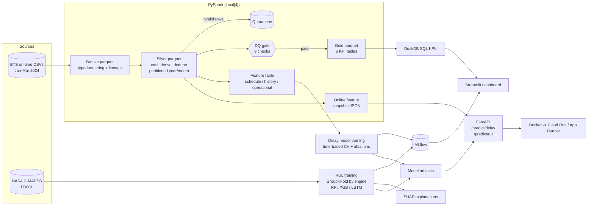
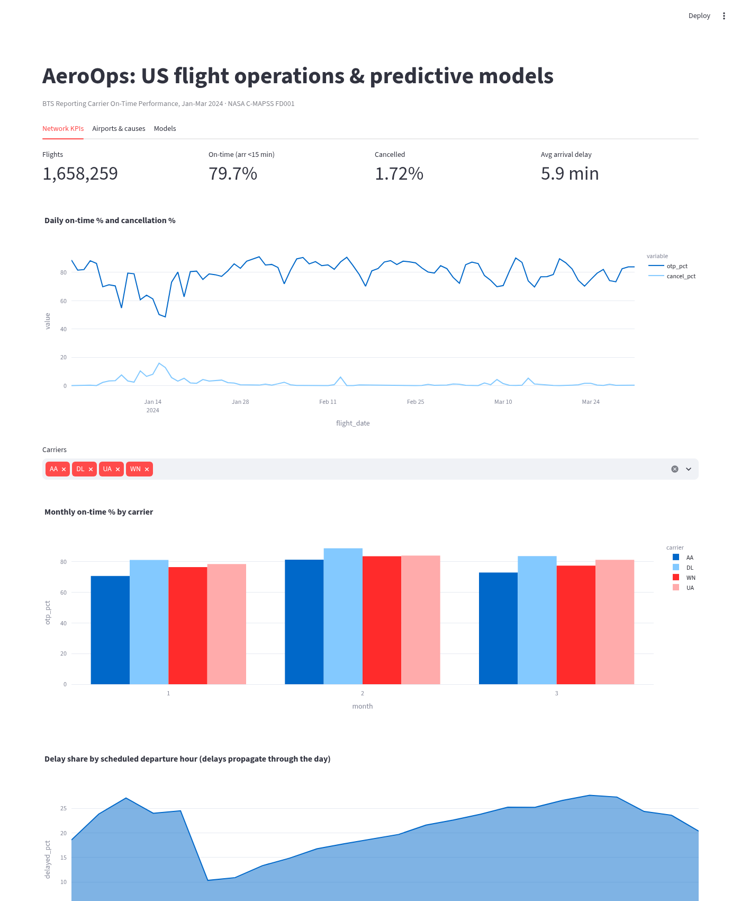
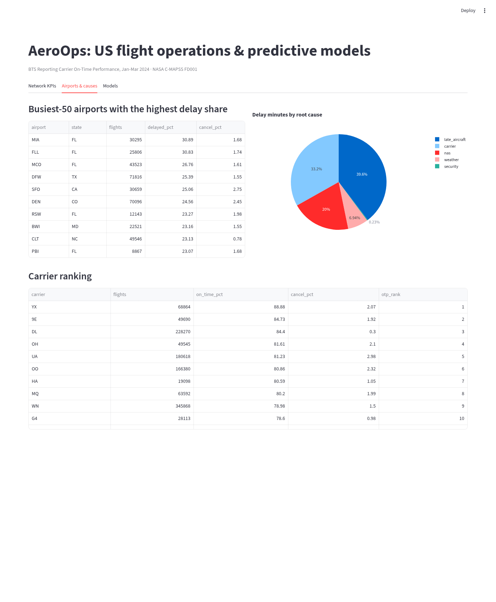
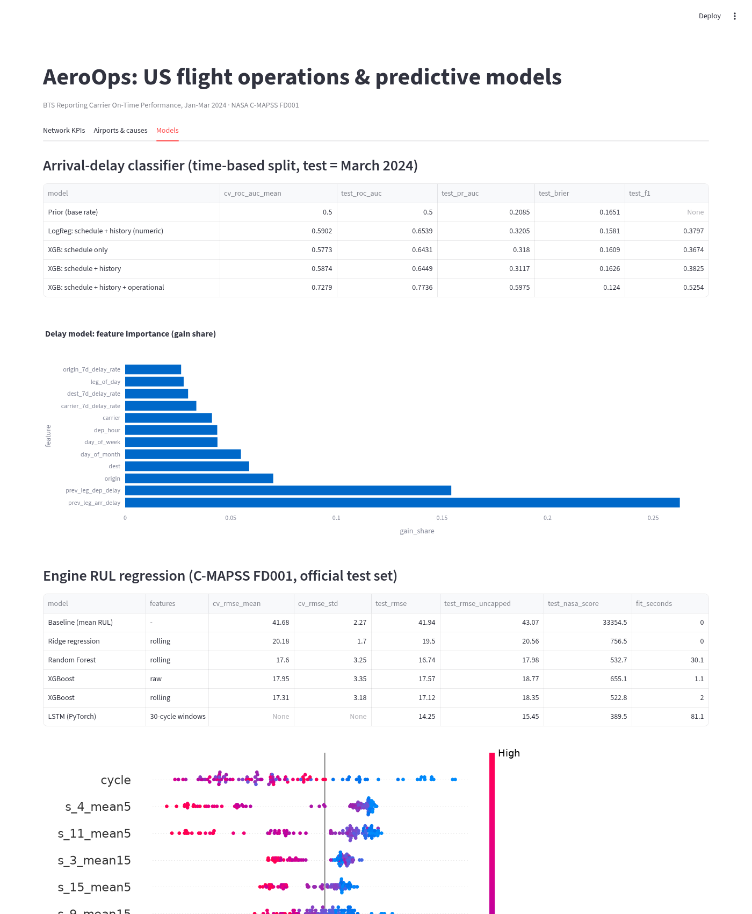

# AeroOps ML: an end-to-end aviation ML system

  

AeroOps ML is one system with two prediction problems on real public aviation data:

| Problem | Data | Model task | Validation |
|---|---|---|---|
| **Flight arrival delay (≥15 min)** | US DOT / BTS *Reporting Carrier On-Time Performance*, **Jan–Mar 2024, 1,658,259 flights** | Binary classification | Time-based: expanding-window CV + held-out month |
| **Engine remaining useful life (RUL)** | NASA C-MAPSS turbofan simulation, **FD001** (100 train / 100 test engines) | Regression | 5-fold GroupKFold *by engine* + official test set |

It covers the full lifecycle: a **PySpark medallion pipeline** (bronze → silver → gold, partitioned parquet, data-quality gates) feeds a **leakage-safe Spark feature pipeline**. On top of that sit a **DuckDB SQL KPI layer**, models tracked in **MLflow** with baselines and ablations, **SHAP** explanations, a **FastAPI** service with load-test benchmarks, a **Streamlit** dashboard, a **Docker** image, and **Cloud Run / AWS App Runner** deploy configs.

> Every number in this README comes from a run in this repo's own scripts (results live in `reports/`). Hardware: a shared 8-vCPU Linux box, CPU only, `local[4]` Spark.

---

## Architecture



## Results

### 1. Data pipeline (BTS Jan–Mar 2024)

From `reports/pipeline_run.json` and `reports/data_quality.json`:

| Stage | Rows | Wall time |
|---|---|---|
| Raw CSV → bronze parquet (748 MB CSV → 22 MB parquet) | 1,658,259 | 13.3 s |
| Bronze → silver (cast, derive, dedupe, quarantine) | 1,658,259 (0 quarantined, 0 duplicates) | 18.0 s |
| Data-quality gate (9 checks, 6 blocking) | all blocking checks passed; 1 warning: 6 rows with arrival delay > 48 h | 2.7 s |
| Silver → 6 gold tables | 91 daily, 29,456 airport-day, 5,887 route rows | 5.8 s |
| Spark feature pipeline (operated flights only) | 1,626,052 labelled rows | 23 s end-to-end (incl. JVM start) |

Headline KPIs from the SQL layer (`sql/`, `reports/kpis.md`): 79.7% on-time arrivals, 1.72% cancelled, 5.9 min average arrival delay. **Late-arriving aircraft cause 39.6% of all delay minutes**, more than any other BTS cause code. That finding drove the "operational" feature group below.

### 2. Flight-delay classifier (target: arrival delay ≥ 15 min)

Train Jan 1–Feb 29 (1,040,639 flights), **test = March 2024 (585,413 flights, 20.85% positive)**. CV = 2 expanding-window folds inside Jan–Feb. The decision threshold is picked on the last CV fold to maximise F1, then applied unchanged to March.

| Model | Features | CV ROC-AUC | Test ROC-AUC | Test PR-AUC | Test Brier | Test F1 |
|---|---|---|---|---|---|---|
| Prior (base rate) | none | 0.500 | 0.500 | 0.209 | 0.165 | n/a |
| Logistic regression | schedule + history (numeric) | 0.590 ± 0.016 | 0.654 | 0.321 | 0.158 | 0.380 |
| XGBoost | schedule only | 0.577 ± 0.027 | 0.643 | 0.318 | 0.161 | 0.367 |
| XGBoost | schedule + history | 0.587 ± 0.014 | 0.645 | 0.312 | 0.163 | 0.383 |
| **XGBoost** | **schedule + history + operational** | **0.728 ± 0.015** | **0.774** | **0.598** | **0.124** | **0.525** |

The best model on March reaches 0.498 precision and 0.556 recall at threshold 0.27. The top features by gain share are `prev_leg_arr_delay` (26.3%), `prev_leg_dep_delay` (15.4%) and `origin` (7.0%).

**Ablation takeaway:** schedule and rolling history features barely beat logistic regression; they nearly match it. Adding the inbound aircraft's previous-leg delay lifts test PR-AUC from 0.312 to 0.598. Delay *propagation* is the signal, which matches the 39.6% late-aircraft share above.

### 3. Engine RUL regression (C-MAPSS FD001)

Target is piece-wise linear RUL capped at 125 cycles. The test score is taken at each engine's last observed cycle against `RUL_FD001.txt`. CV truncates each validation engine at a random cycle so it mimics the test protocol.

| Model | Features | CV RMSE (5-fold by engine) | Test RMSE | Test RMSE (uncapped truth) | NASA score ↓ |
|---|---|---|---|---|---|
| Baseline (mean RUL) | none | 41.68 ± 2.27 | 41.94 | 43.07 | 33,354.5 |
| Ridge regression | rolling | 20.18 ± 1.70 | 19.50 | 20.56 | 756.5 |
| Random Forest | rolling | 17.60 ± 3.25 | 16.74 | 17.98 | 532.7 |
| XGBoost | raw sensors | 17.95 ± 3.35 | 17.57 | 18.77 | 655.1 |
| XGBoost | raw + rolling mean/std (5, 15) | 17.31 ± 3.18 | 17.12 | 18.35 | 522.8 |
| **LSTM (PyTorch, 2×64)** | 30-cycle windows | not run (see note) | **14.25** | **15.45** | **389.5** |

Ablation: rolling features improve XGBoost's test RMSE from 17.57 to 17.12 and its NASA score from 655 to 523. The LSTM fits in 81 s on 4 CPU threads. Note: the LSTM uses fixed, a-priori hyper-parameters and was **not** cross-validated (CV RMSE not run), so compare it on the test column only. SHAP (`reports/shap_summary_FD001.png`) ranks `cycle`, `s_4_mean5` (T50, LPT outlet temperature) and `s_11_mean5` (Ps30, HPC outlet static pressure) highest.

### 4. Serving benchmarks (FastAPI, 1 uvicorn worker, same shared box)

Measured with `scripts/benchmark_api.py`: 2,000 requests per row after a 20-request warm-up, randomised payloads.

| Endpoint | Concurrency | p50 | p95 | p99 | Throughput |
|---|---|---|---|---|---|
| `/predict/delay` | 1 | 10.5 ms | 27.6 ms | 32.5 ms | 77.6 req/s |
| `/predict/delay` | 16 | 148.0 ms | 202.4 ms | 244.2 ms | 106.6 req/s |
| `/predict/rul` (30 cycles of history) | 1 | 25.8 ms | 46.0 ms | 52.3 ms | 33.4 req/s |
| `/predict/rul` (30 cycles of history) | 16 | 614.7 ms | 734.8 ms | 811.9 ms | 25.8 req/s |

A single worker is CPU-bound, so higher concurrency mostly adds queueing. The RUL path is dominated by the pandas group-by/rolling feature code; see the next steps below.

## Dashboard

| Network KPIs | Airports & delay causes | Models |
|---|---|---|
|  |  |  |

Screenshots are rendered headlessly with Playwright (`scripts/screenshot_dashboard.py`).

## Design decisions and trade-offs

- **Medallion layout with a quarantine table.** Bad rows are kept and isolated rather than dropped. The pipeline fails if more than 1% of rows are quarantined or any blocking check fails, so silent data loss can't happen.
- **Bronze stores raw values as strings.** Casting happens in silver, so a schema change upstream never breaks ingestion and can be replayed.
- **Leakage-safe history features.** Rolling rates use a Spark `rangeBetween(-N, -1)` window over day indices, so the flight's own day is excluded. A unit test (`test_history_features_use_only_prior_days`) enforces this.
- **Feature-group ablations instead of one big model.** They show *where* the signal is. Operational features assume the prediction is made close to departure, once the inbound leg has landed. For a D-1 forecast you'd use the "schedule + history" row.
- **Time-based splits for flights, group splits for engines.** Random row splits leak in both problems: adjacent days share weather, and adjacent engine cycles are nearly identical.
- **Offline/online parity.** The same Spark job writes the training features and the *online snapshot* the API reads (`models/online_features.json`). Feature names live in a Spark-free module (`flights/schema.py`) shared by both sides. Unseen airports or carriers are reported back as `unknown_categories` and treated as missing.
- **Capped RUL (125).** This is standard for C-MAPSS. RMSE against uncapped truth is reported too, for transparency.
- **XGBoost serves RUL even though the LSTM scores better.** It keeps the image torch-free (small, fast cold start on Cloud Run). The LSTM is a candidate for a separate model server.

## Quickstart

```bash
python -m venv .venv && source .venv/bin/activate
pip install -r requirements-dev.txt            # needs Java 17+ for PySpark
make data          # BTS Jan-Mar 2024 (~750 MB CSV) + NASA C-MAPSS (~12 MB), git-ignored
make train         # pipeline -> features -> KPIs -> delay model -> RUL models -> SHAP
# Training defaults MLFLOW_TRACKING_URI to sqlite:///mlruns.db (MLflow 3 rejects ./mlruns).
# Override with: export MLFLOW_TRACKING_URI=sqlite:///mlflow.db
mlflow ui --backend-store-uri sqlite:///mlruns.db   # browse every run
make serve         # FastAPI on :8000  (docs at /docs)
make bench         # latency/throughput benchmark (in another shell)
make dashboard     # Streamlit on :8501
make test          # 17 tests: Spark transforms, DQ, leakage, SQL, metrics, API
```

Example request:

```bash
curl -X POST localhost:8000/predict/delay -H 'content-type: application/json' -d \
 '{"carrier":"WN","origin":"DEN","dest":"LAS","flight_date":"2024-04-02","dep_hour":18,
   "distance":628,"prev_leg_arr_delay":45,"prev_leg_dep_delay":50,"leg_of_day":3}'
# {"delay_probability":0.8533,"predicted_delayed":true,"threshold":0.27,"history_as_of":"2024-03-31",...}
```

## Deploy (configs only; not deployed from this repo)

- **Docker:** `make train && docker build -t aeroops-api .` produces a slim, torch-free serving image that runs as a non-root user with a health check.
- **GCP Cloud Run:** `PROJECT_ID=... deploy/gcp/deploy.sh` (Artifact Registry + Cloud Run), or `gcloud run services replace deploy/gcp/service.yaml`.
- **AWS App Runner:** `deploy/aws/deploy.sh` (ECR push + `apprunner.json`).

No cloud credentials are stored in the repo. The CI workflow (ruff, pytest with Java 17, Docker build) is in `ci/github-actions-ci.yml`. To enable it, copy it to `.github/workflows/ci.yml`.

## Repository layout

```
src/aeroops/flights/   transform.py (bronze/silver/gold) · quality.py · pipeline.py · features.py · schema.py · train_delay.py
src/aeroops/rul/       data.py · features.py · lstm.py · train.py · explain.py · metrics.py
src/aeroops/serving/   api.py (FastAPI)
src/aeroops/kpis.py    DuckDB runner for sql/*.sql
dashboard/app.py       Streamlit
scripts/               data download, API benchmark, dashboard screenshots
deploy/                Cloud Run + App Runner configs
reports/               every metric quoted above (JSON/Markdown) + SHAP plot
```

## How to talk about this in an interview

- **"Walk me through the system."** Spark medallion pipeline with DQ gates, then leakage-safe features, then time-split CV with ablations tracked in MLflow, then FastAPI using the same feature definitions, then Docker/Cloud Run. Lead with the 1.66M-flight, 3-month scale.
- **"How did you validate?"** Expanding-window CV and a held-out future month for flights. GroupKFold by engine for C-MAPSS. Explain why random K-fold would inflate scores in both cases.
- **"What did the ablation teach you?"** Schedule and history features alone only reach a test ROC-AUC of 0.645. The previous-leg delay lifts it to 0.774 (PR-AUC 0.312 to 0.598), consistent with late aircraft causing 39.6% of delay minutes. Be explicit that this assumes prediction near departure time.
- **"Why PR-AUC and Brier, not just accuracy?"** 20.85% positives: accuracy rewards predicting "on time". PR-AUC measures ranking of the minority class, and Brier measures calibration, which matters if ops teams act on probabilities.
- **"Why is the LSTM better but not served?"** Trade-off between accuracy (14.25 vs 17.12 RMSE) and image size, cold start and operational simplicity. It wasn't cross-validated either, which you should own.
- **"How would you scale serving?"** More workers and instances (Cloud Run autoscaling), vectorised NumPy features instead of pandas rolling for `/predict/rul`, batching, and a real online store (Redis/DynamoDB) instead of a JSON snapshot.

## Next steps

- Hyper-parameter search with Optuna logged to MLflow. Probability calibration (isotonic) for the delay model.
- Weather joins (NOAA) for a stronger D-1 model. FD002–FD004 (multiple operating conditions) for RUL.
- MLflow Model Registry, plus drift monitoring on the online snapshot.

## Data and licence

BTS on-time data is published by the US Department of Transportation (public domain). NASA C-MAPSS comes from the NASA Prognostics Data Repository (A. Saxena, K. Goebel, 2008). Neither dataset is committed; use `make data`. Code is MIT licensed.
